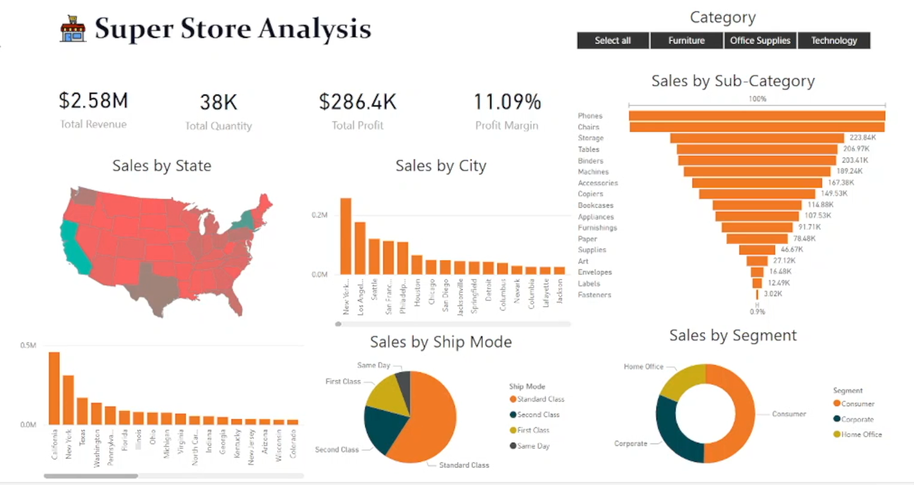
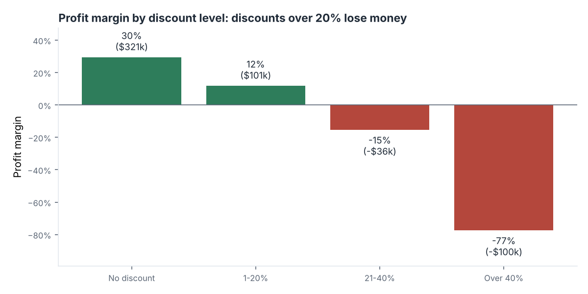
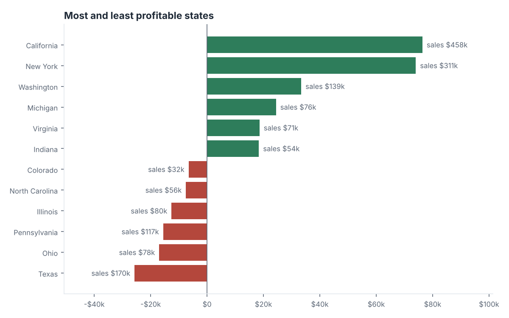
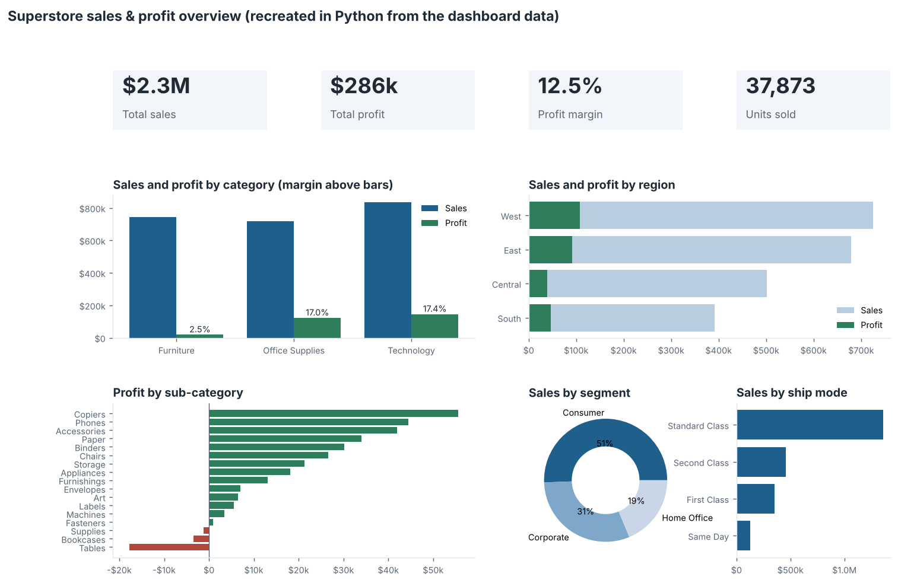

# Superstore Sales & Profit Dashboard (Power BI)


A Power BI dashboard for a US office-supplies retailer: **9,994 order lines**, **$2.3M in sales** across 49 states. My [first version](dashboard/superstore_sales.pbix) focused on where sales come from. Revisiting it, I added the question that matters more to the business: **where is the money actually made, and where is it lost?**



*My Power BI dashboard. Open [`dashboard/superstore_sales.pbix`](dashboard/superstore_sales.pbix) in Power BI Desktop for the interactive version, with a map, drill-downs and a category filter. Checking it against the raw data showed that the $2.58M "Total Revenue" card isn't revenue. See [What I changed](#what-i-changed-from-the-first-version).*

## Headline numbers

| KPI | Value |
|---|---|
| Total sales | $2,297,201 |
| Total profit | $286,397 |
| Profit margin | 12.5% |
| Units sold | 37,873 |
| Order lines sold at a loss | 18.7% |

Every figure is recalculated from the raw CSV by [`analysis/superstore.py`](analysis/superstore.py), and tests check them on every change, so the dashboard and the code can't quietly disagree.

## Key insights

### 1. Discounts over 20% lose money on every sale



| Discount | Profit margin | Profit |
|---|---|---|
| None | 29.5% | $320,988 |
| 1–20% | 11.9% | $100,785 |
| 21–40% | −15.3% | −$35,817 |
| Over 40% | **−77.4%** | **−$99,559** |

Heavily discounted orders lost **$135,000**, enough to wipe out almost half of all profit. **Recommendation:** cap routine discounts at 20%, and require approval for anything deeper.

### 2. Furniture sells well but barely makes money

| Category | Sales | Profit | Margin |
|---|---|---|---|
| Technology | $836,154 | $145,455 | 17.4% |
| Office Supplies | $719,047 | $122,491 | 17.0% |
| Furniture | $742,000 | $18,451 | **2.5%** |

Within Furniture, **tables (−$17,725)** and **bookcases (−$3,473)** lose money outright. Their margin problem lines up with the heavy discounting above.

### 3. Texas is a top market by sales, and the biggest loss-maker



Texas had the **3rd-highest sales ($170k)** but the **largest loss of any state (−$25,729)**. Ohio, Pennsylvania and Illinois also lose money despite healthy sales. California and New York together bring in more than half of all profit ($150k of $286k).

### 4. Where sales come from

- **Segments:** Consumer 51%, Corporate 31%, Home Office 19%.
- **Ship modes:** Standard Class carries 59% of sales.
- **Regions:** the West leads on both sales ($725k) and profit ($108k). The Central region has the weakest margin (7.9%).

## What I changed from the first version

- **Fixed the revenue and margin cards.** The card labelled "Total Revenue" ($2.58M) was calculated as **Sales + Profit**. Profit is already part of sales, so this counts it twice. Real sales are **$2,297,201**. Because the Profit Margin card divided by that inflated figure, it showed **11.09%** instead of the true **12.5%**. Both cards now use Total Sales. See [`docs/dax_measures.md`](docs/dax_measures.md).
- **Added the profit view.** The original visuals showed sales only. The losses from discounting, tables and Texas are invisible on a sales-only dashboard.
- **Made the numbers checkable.** A Python script recalculates every KPI, and tests run automatically on every push.

The updated layout, with the profit view, recreated in Python:



**Data note:** there are 17 rows that are exact copies of other rows. Without an order ID it's impossible to tell repeat orders from duplicates, so they are kept, and they change totals by less than 0.1%.

## Repository layout

```
├── dashboard/superstore_sales.pbix   the Power BI report
├── data/SampleSuperstore.csv         9,994 order lines
├── analysis/superstore.py            KPI checks and README charts
├── analysis/kpis.json                recalculated KPIs
├── docs/dax_measures.md              measures, and the card I removed
├── tests/test_kpis.py
└── images/
```

## Run the checks

```bash
git clone https://github.com/ranzith1282000-beep/superstore-sales-dashboard.git
cd superstore-sales-dashboard
pip install -r requirements.txt
python analysis/superstore.py
pytest
```

## Tools

Power BI Desktop, DAX, Python (pandas, Matplotlib), pytest, GitHub Actions
